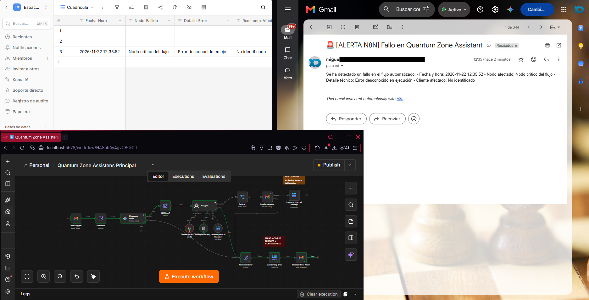
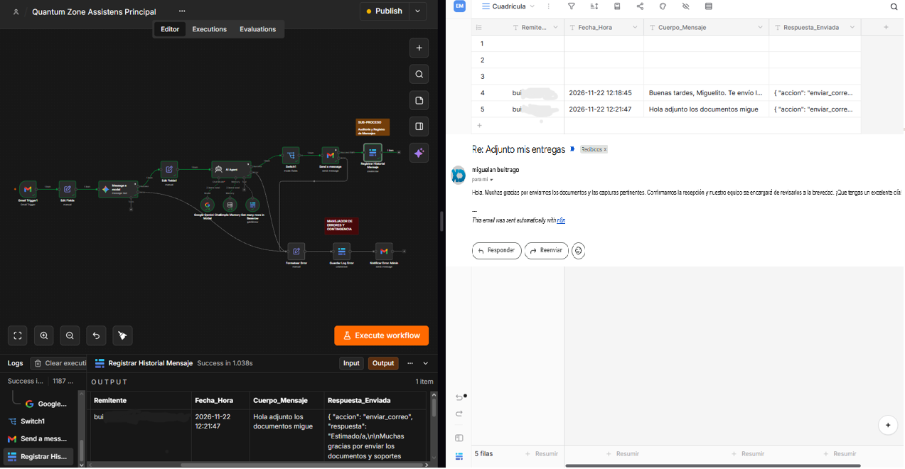
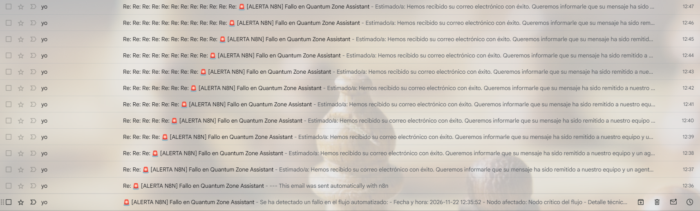

# Documentación Técnica Final — Quantum Zone Assistants

**Curso:** Automatización Inteligente de Procesos con n8n
**Institución:** Institución Universitaria EAM — Periodo 2026-II
**Docente:** Robert García Rey
**Equipo:** Miguel Angel Liévano Buitrago · Carlos Mario Patiño Ramirez · Carlos Andrés López Perez
**Workflow:** [`workflows/Workflow_Final.json`](../workflows/Workflow_Final.json)

---

## 1. Resumen

Quantum Zone Assistants es un asistente de atención por correo construido en **n8n**. Monitorea una bandeja de Gmail, clasifica cada mensaje con **Google Gemini**, consulta en **Baserow** las instrucciones de respuesta de cada categoría, responde al remitente, deja un registro de auditoría de cada interacción y gestiona los fallos técnicos con una rama de contingencia que guarda logs y avisa al administrador.

## 2. Problema y objetivo

**Problema.** La recepción manual de correos con solicitudes, consultas y soportes genera tiempos de respuesta altos, falta de trazabilidad sobre qué mensajes fueron atendidos y pérdida de contexto cuando un usuario vuelve a escribir.

**Objetivo.** Automatizar la lectura, el análisis y la respuesta de esos correos, con auditoría completa de cada interacción y manejo controlado de errores.

## 3. Proceso antes y después

| Aspecto | Proceso manual | Proceso automatizado |
| :-- | :-- | :-- |
| Detección de correos | Una persona revisa la bandeja | `Gmail Trigger1` consulta cada minuto |
| Clasificación | Criterio del operador | Gemini asigna una categoría |
| Respuesta | Redacción manual | El agente redacta según instrucciones guardadas en Baserow |
| Trazabilidad | Ninguna o dispersa | Fila en `Historial_Mensajes` por cada respuesta enviada |
| Fallos | No se detectan o se detectan tarde | Log en `Logs_Errores` y alerta por correo |

Los diagramas de proceso están referenciados en el README (`documentacion/diagramas/Proceso_Manual.png` y `Proceso_Automatizado.png`).

## 4. Arquitectura

### 4.1 Servicios

| Servicio | Rol |
| :-- | :-- |
| **n8n** | Orquestación, enrutamiento y manejo de excepciones. |
| **Google Gemini** | Clasificación del correo y redacción de la respuesta mediante un `AI Agent`. |
| **Gmail** | Disparador de entrada, envío de respuestas y envío de alertas. |
| **Baserow** | Fuente de instrucciones por categoría, auditoría y bitácora de errores. |

### 4.2 Recorrido del flujo

```
Gmail Trigger1 → Edit Fields → Message a model → Edit Fields1 → AI Agent → Switch1 → Send a message → Registrar Historial Mensaje
                                      │                              │                        │
                                      └──────────────┬───────────────┴────────────────────────┘
                                                     ▼ (salidas de error)
                                   Formatear Error → Guardar Log Error → Notificar Error Admin
```



### 4.3 Descripción de nodos

| Nodo | Tipo | Función |
| :-- | :-- | :-- |
| `Gmail Trigger1` | Gmail Trigger | Consulta cada minuto con el filtro `-subject:"[ALERTA N8N]" -from:me`. |
| `Edit Fields` | Set | Extrae `cuerpo` (texto del correo) y `categoria` (etiqueta de Gmail, `labelIds[1]`). |
| `Message a model` | Google Gemini (`gemini-3.5-flash-lite`) | Primer análisis del correo. Su respuesta debe ser un JSON. |
| `Edit Fields1` | Set | Lee el campo `categoria` de la respuesta de Gemini y lo pasa al agente. |
| `AI Agent` | Agente LangChain | Redacta la respuesta según la categoría y devuelve `{ "accion", "respuesta" }`. |
| `Google Gemini Chat Model` | Modelo del agente (`gemini-3.5-flash`) | Motor de lenguaje del agente. |
| `Simple Memory` | Memoria de ventana | Clave de sesión: el `id` del mensaje de Gmail. |
| `Get many rows in Baserow` | Herramienta Baserow | El agente la usa para leer las instrucciones de una categoría. |
| `Switch1` | Switch | Deja pasar solo la acción `enviar_correo`. |
| `Send a message` | Gmail | Envía la respuesta con asunto `Re: <asunto original>`. |
| `Registrar Historial Mensaje` | Baserow | Crea la fila de auditoría con zona horaria `America/Bogota`. |
| `Formatear Error` | Set | Normaliza fecha, nodo de origen, mensaje y cliente afectado. |
| `Guardar Log Error` | Baserow | Crea la fila en `Logs_Errores`. |
| `Notificar Error Admin` | Gmail | Envía la alerta `🚨 [ALERTA N8N] Fallo en Quantum Zone Assistant`. |

## 5. Lógica de la IA

El agente actúa según la categoría del correo:

| Categoría | Acción | Resultado |
| :-- | :-- | :-- |
| `spam` | `archivar` | No se redacta respuesta. |
| `entregas_evidencias` | `enviar_correo` | Agradecimiento breve y confirmación de que el equipo revisará los soportes. |
| `preguntas` | `enviar_correo` | Respuesta detallada, formal y cercana a las dudas planteadas. |
| `default` | `enviar_correo` | Aviso de recepción y contacto de un agente humano en 24 horas laborables. |

El agente debe devolver siempre un JSON plano con los campos `accion` y `respuesta`, sin bloques de código markdown. `Switch1` y `Send a message` leen ese JSON con `JSON.parse`.

## 6. Modelo de datos (Baserow)

**`entregas_evidencias`** (consulta): instrucciones por categoría. El flujo usa los campos `accion_requerida` e `instrucciones_respuesta`.

**`Historial_Mensajes`** (auditoría)

| Columna | Tipo |
| :-- | :-- |
| `Remitente` | Single line text |
| `Fecha_Hora` | Single line text |
| `Cuerpo_Mensaje` | Long text |
| `Respuesta_Enviada` | Long text |

**`Logs_Errores`** (contingencia)

| Columna | Tipo |
| :-- | :-- |
| `Fecha_Hora` | Single line text |
| `Nodo_Fallido` | Single line text |
| `Detalle_Error` | Long text |
| `Remitente_Afectado` | Single line text |

## 7. Manejo de errores y contingencia

Los nodos `Message a model`, `AI Agent` y `Send a message` usan la opción *Continue using error output*. Sus salidas de error convergen en `Formatear Error`, que arma el registro con valores de respaldo (`Nodo crítico del flujo`, `Error desconocido en ejecución`, `No identificado`) cuando el error no trae el detalle. Después `Guardar Log Error` escribe en Baserow y `Notificar Error Admin` envía el correo.

**Prevención de bucles.** La alerta llega a una bandeja y podría ser leída como una solicitud nueva. Esto ocurrió en la prueba `PRU-03` (ver sección 8) y se resolvió con dos medidas:

1. Filtro de exclusión en `Gmail Trigger1`: `-subject:"[ALERTA N8N]" -from:me`.
2. Destino de alertas separado de la bandeja de clientes.

## 8. Pruebas

El detalle completo está en [`pruebas/Bitacora_Clase_11_Pruebas.md`](../pruebas/Bitacora_Clase_11_Pruebas.md).

| ID | Caso | Resultado |
| :-- | :-- | :-- |
| `PRU-01` | Flujo exitoso: respuesta automática y auditoría | Cumple |
| `PRU-02` | Fallo simulado: log en Baserow y alerta por correo | Cumple |
| `PRU-03` | Bucle infinito de alertas | Falló al inicio; cerrado tras aplicar el filtro de exclusión |





## 9. Instalación y ejecución

**Requisitos:** n8n `1.70.0` o superior; cuenta de Google con OAuth2 para Gmail; API Key de Google AI Studio; cuenta de Baserow con token de base de datos (lectura y escritura).

1. Crear en Baserow las tres tablas de la sección 6.
2. En n8n, importar `workflows/Workflow_Final.json` (**Import from File...**).
3. Asignar las credenciales de Gmail, Google Gemini y Baserow, y seleccionar el *Database ID* y *Table ID* de cada tabla.
4. En `Send a message` y `Notificar Error Admin`, reemplazar los correos ficticios del JSON público por los reales.
5. Probar con **Execute workflow** y activar con **Active / Publish** para operación continua.
6. Desactivar el workflow al terminar las pruebas para evitar consumo de cuota de API y polling continuo de Gmail.

**Ejemplo reproducible.** Enviar a la cuenta monitoreada un correo con el asunto `Adjunto mis entregas` y el cuerpo `Hola adjunto los documentos`. Se espera una respuesta automática de confirmación y una fila nueva en `Historial_Mensajes`. Para el caso de fallo, cambiar temporalmente el `Table ID` de `Registrar Historial Mensaje` por uno inexistente y verificar la fila en `Logs_Errores` y la alerta por correo.

## 10. Limitaciones conocidas

- La herramienta `Get many rows in Baserow` maneja sus errores internamente y los devuelve como observación al modelo, por lo que no detiene el flujo. Las fallas de infraestructura se capturan en los nodos principales.
- `Simple Memory` es volátil y se reinicia si se reinicia el servidor local de n8n. Además usa el `id` del mensaje como clave, así que el contexto se mantiene dentro de un correo y no entre correos distintos del mismo remitente.
- `Switch1` solo tiene salida para `enviar_correo`. Cuando la acción es `archivar` (spam), el flujo termina sin archivar el correo.
- `Gmail Trigger1` incluye spam y papelera en la consulta (`includeSpamTrash: true`).
- Los destinatarios del JSON público son direcciones ficticias y deben configurarse antes de usar el flujo.

## 11. Posibles mejoras

- Implementar la rama `archivar` con un nodo de Gmail que etiquete o archive el correo.
- Responder al remitente original (`from`) en lugar de una dirección fija.
- Usar la dirección del remitente como clave de `Simple Memory` para conservar contexto entre correos.
- Agregar reintentos ante fallos transitorios de Gemini o Gmail.
