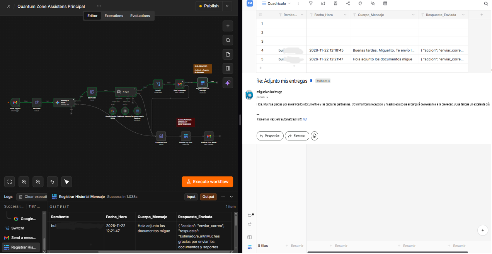
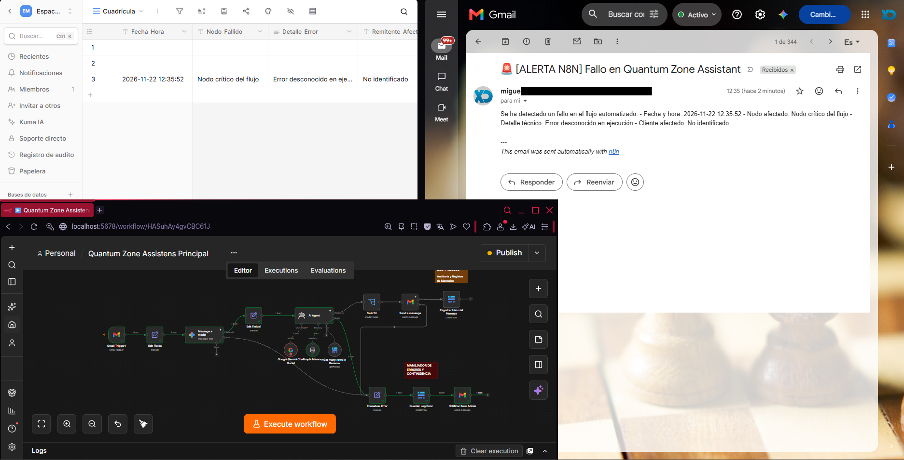
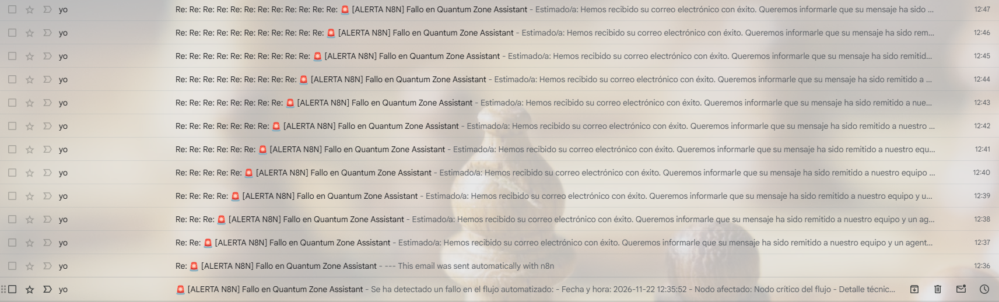

# Bitácora de Pruebas — Clase 11

**Proyecto:** Quantum Zone Assistants
**Workflow probado:** `Workflow_Final.json`
**Fecha de ejecución de las pruebas:** 2026-11-22
**Entorno:** n8n local (`localhost:5678`), Gmail OAuth2, Baserow (token de base de datos), Google Gemini

## Resumen de casos

| ID | Caso | Resultado | Evidencia |
| :-- | :-- | :-- | :-- |
| `PRU-01` | Flujo exitoso: consulta, respuesta y auditoría | Cumple | `Prueba_Envio.png` |
| `PRU-02` | Simulación de fallo técnico y contingencia | Cumple | `Caso_Fallo_Simulado.png` |
| `PRU-03` | Prevención de bucle infinito en notificaciones de error | Cerrado / Cumple (tras ajuste) | `Prueba_Bucle_Infinito.png` |

---

#### Caso de Prueba: `PRU-01` — Flujo Exitoso (Respuesta Automática y Auditoría)

- **Objetivo:** Verificar que un correo entrante es analizado por la IA, respondido automáticamente al remitente y registrado en la tabla `Historial_Mensajes` de Baserow.

- **Versión probada:** `Workflow_Final.json` (v1.0).

- **Condiciones iniciales:** Flujo en ejecución con `Gmail Trigger1` consultando cada minuto, credenciales de Gmail, Gemini y Baserow conectadas, y tabla `Historial_Mensajes` creada con sus cuatro columnas.

- **Entrada exacta:** Correo con asunto `Adjunto mis entregas` y cuerpo `Hola adjunto los documentos migue`, enviado a la cuenta monitoreada.

- **Resultado esperado:** El remitente recibe un correo automático que confirma la recepción, y se crea una fila nueva en `Historial_Mensajes` con remitente, fecha/hora, cuerpo original y respuesta enviada.

- **Lo observado:** **Cumple.**
  - El remitente recibió la respuesta `Re: Adjunto mis entregas`, con un texto que agradece el envío de los documentos y confirma que el equipo los revisará a la brevedad.
  - El nodo `Registrar Historial Mensaje` terminó en `Success` (1.038 s) con la salida `Fecha_Hora = 2026-11-22 12:21:47`.
  - La tabla `Historial_Mensajes` muestra la fila 5 con esos datos. La columna `Respuesta_Enviada` guarda el JSON del agente (`{"accion": "enviar_correo", "respuesta": ...}`).
  - La fila 4 (12:18:45) corresponde a una ejecución previa de prueba.

- **Evidencia asociada:** `evidencias/Prueba_Envio.png`



- **Estado final:** **Cumple.**

---

#### Caso de Prueba: `PRU-02` — Simulación de Fallo Técnico (Manejador de Errores)

- **Objetivo:** Verificar que, ante un fallo en un nodo crítico, la rama de contingencia registra el error en `Logs_Errores` y notifica al administrador.

- **Versión probada:** `Workflow_Final.json` (v1.0).

- **Condiciones iniciales:** Tablas `Historial_Mensajes` y `Logs_Errores` creadas, y salidas de error (*Continue using error output*) activadas en `Message a model`, `AI Agent` y `Send a message`.

- **Entrada exacta:** Fallo controlado en un nodo crítico, que activa la rama `Formatear Error` → `Guardar Log Error` → `Notificar Error Admin`.

- **Resultado esperado:** Se crea una fila en `Logs_Errores` y llega un correo con el asunto `🚨 [ALERTA N8N] Fallo en Quantum Zone Assistant`.

- **Lo observado:** **Cumple.**
  - `Logs_Errores` registró la fila 3 con `Fecha_Hora = 2026-11-22 12:35:52`, `Nodo_Fallido = Nodo crítico del flujo`, `Detalle_Error = Error desconocido en ejecución` y `Remitente_Afectado = No identificado`.
  - Llegó a Gmail la alerta `🚨 [ALERTA N8N] Fallo en Quantum Zone Assistant` a las 12:35, con fecha, nodo afectado, detalle técnico y cliente afectado.
  - Esos valores coinciden con los textos por defecto de `Formatear Error`: la entrada de error de la simulación no traía el detalle del nodo, y el flujo cayó en sus valores de respaldo.
  - Las filas 1 y 2 de la tabla están vacías (filas iniciales de Baserow).

- **Evidencia asociada:** `evidencias/Caso_Fallo_Simulado.png`



- **Estado final:** **Cumple.** La alerta de este caso es la que detonó el hallazgo de `PRU-03`.

---

#### Caso de Prueba: `PRU-03` — Prevención de Bucle Infinito en Notificaciones de Error

- **Objetivo:** Verificar el comportamiento del disparador (`Gmail Trigger1`) cuando el manejador de errores envía una notificación por correo electrónico hacia la misma cuenta monitoreada.

- **Versión probada:** `Workflow_Final.json` (v1.0 - antes de aplicar filtros de exclusión).

- **Condiciones iniciales:** Flujo publicado/activo (`Active`) con intervalo de consulta de 1 minuto en `Gmail Trigger1`, y nodo `Notificar Error Admin` apuntando a la misma cuenta de Gmail conectada al disparador.

- **Entrada exacta:** Simulación de fallo en nodo crítico que dispara la rama de contingencia con asunto `🚨 [ALERTA N8N] Fallo en Quantum Zone Assistant`.

- **Resultado esperado:** El sistema registra el fallo en Baserow, envía una única alerta al administrador y finaliza la ejecución sin volver a disparar el flujo.

- **Lo observado (Hallazgo):** **No cumple inicialmente.** Al llegar el correo de alerta a la misma bandeja monitoreada, `Gmail Trigger1` lo detectó como una nueva solicitud de cliente, ejecutó el agente de IA, respondió automáticamente al correo de alerta y generó un **bucle infinito de respuestas en cadena** (`Re: Re: Re: ... 🚨 [ALERTA N8N]`) cada minuto.
  - La alerta original salió a las 12:35:52. Desde las 12:36 hasta las 12:47 la captura muestra una respuesta por minuto, cada una con un `Re:` más en el asunto.
  - El cuerpo de las respuestas es el texto estándar de recepción (`Estimado/a: Hemos recibido su correo electrónico con éxito...`).

- **Evidencia asociada:** `evidencias/Prueba_Bucle_Infinito.png`



#### Ajuste Realizado y Cierre de Pendiente

- **Causa raíz:** Ausencia de reglas de exclusión en el nodo de entrada (`Gmail Trigger1`) para filtrar correos autogenerados por el propio sistema (`-from:me`) o alertas técnicas del manejador de errores.

- **Solución implementada:**

  1. Se desactivó de inmediato la ejecución automática para detener la recursividad.
  2. En el nodo **`Gmail Trigger1`** (**Filters → Search**), se configuró la consulta de exclusión:

     ```
     -subject:"[ALERTA N8N]" -from:me
     ```

  3. Se separó la dirección de destino de **`Notificar Error Admin`** para que apunte a un buzón de soporte independiente al buzón de recepción de clientes (configurado con dirección ficticia `soporte@quantumzone-demo.com` en el JSON público).

- **Forma de comprobar el cierre:** Se provocó nuevamente el fallo controlado con el filtro activo; el flujo envió una sola notificación de alerta, registró el log en Baserow y en el siguiente ciclo de revisión `Gmail Trigger1` ignoró el correo sin iniciar nuevas ejecuciones.

- **Estado final:** **Cerrado / Cumple.**

---

## Notas para la entrega

- Antes de publicar el repositorio, censurar los datos personales visibles en las capturas (nombres y correos en `Prueba_Envio.png`, `Caso_Fallo_Simulado.png` y `Prueba_Bucle_Infinito.png`).
- Si se dispone de una captura posterior al ajuste de `PRU-03` (una sola alerta y sin nuevas respuestas), conviene agregarla como `evidencias/Prueba_Bucle_Corregido.png`.
